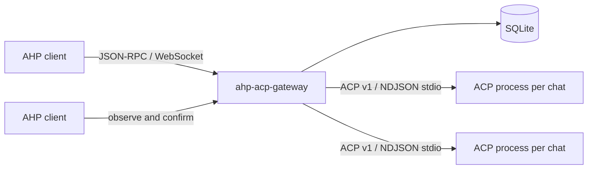

# Architecture

## Components

`GatewayServer` handles authentication, JSON-RPC validation, subscriptions,
commands, and notifications. `GatewayStore` is authoritative: it persists the
next sequence number, action envelope, reduced channel state, catalog metadata,
transcripts, and ACP bindings before an action is broadcast.

`AcpAdapterFactory` is the process-sharing seam. The MVP creates
`AcpV1Process` per chat; a future factory can share one provider process without
changing AHP state ownership.

## Configuration resolution

`ahp-acp-gateway` loads a complete version-1 configuration from the bundled
`ahp-acp-gateway.default.json`. Without `--config`, it binds to loopback,
stores SQLite data under `~/.ahp-acp-gateway/`, and advertises the provider
catalog declared in that file. The bundled JSON is also shipped as a
copyable configuration template.

An explicit JSON file is an overlay rather than a replacement. Scalar sections
replace supplied fields, `providerDefaults` supplies shared process defaults,
and provider entries merge by `id`. A provider can be overridden, added, or
removed with `enabled: false`. TypeScript owns validation, runtime path
expansion, and platform-specific behavior rather than duplicating static
defaults. The resolved config is strict and complete before `GatewayServer` is
constructed.

Provider discovery is declarative: startup never launches a provider merely to
test availability. `npx` downloads and direct-command failures can occur only
after a client creates a session for that provider.

All providers use the same configuration shape (`command`, `args`, `env`,
timeouts, and metadata). Package runners such as `npx`, `uvx`, or `bunx` are
ordinary commands rather than separate provider kinds. Platform-specific
executable resolution, such as `npx.cmd` on Windows, stays inside the process
adapter.

Each configured provider becomes one AHP `AgentInfo`. The provider itself is
the ACP-agent selector used by VS Code. A synthetic `default` model is
advertised until the subprocess starts. `createSession` waits for ACP
initialization and maps ACP's `model` Session Config Option into AHP root
models, while omitting it from the session-config schema so VS Code renders
only one model picker. A selected AHP message model is forwarded through
`session/set_config_option` immediately before the prompt. All non-model
Session Config Options remain in the session schema and are forwarded directly;
complete ACP responses refresh dependent options and model availability.

## Ordering and replay

Every accepted or rejected client action and every server action receives one
monotonic `serverSeq`. SQLite commits the sequence, envelope, and reduced state
in one immediate transaction. Subscribers receive the envelope only after the
commit.

Session creation inserts the session row, default chat row, both channel
snapshots, the root active-session update, and its action envelope in one SQLite
transaction. A constraint or write failure leaves none of those records behind.

Reconnect uses the retained action window when the client's
`lastSeenServerSeq` is still available. If the gap predates the window, the
gateway returns fresh snapshots for all surviving subscriptions.

## Restart behavior

SQLite restores root/session/chat catalogs and completed transcripts. At
startup, any persisted `activeTurn` is atomically finalized with an error part
whose `errorType` is `host_restarted`; the parent session summary is updated to
the same error state.

ACP binding metadata stores the provider ID, ACP session ID, and observed
`loadSession` support. The next prompt starts a fresh process:

- if `session/load` is supported, the existing ACP session ID is loaded;
- otherwise `session/new` is used and a system notification is appended to the
  active AHP turn to make the context reset visible.

## Mapping

ACP session updates map to AHP actions in arrival order:

| ACP v1 update | AHP representation |
|---|---|
| `agent_message_chunk` | markdown `chat/responsePart` + `chat/delta` |
| `agent_thought_chunk` | reasoning part + `chat/reasoning` |
| plan updates | markdown plan block |
| `tool_call` | `chat/toolCallStart` and, when running, `chat/toolCallReady` |
| `tool_call_update` | ready/complete tool lifecycle actions |
| permission request | pending-confirmation tool call with AHP options |
| prompt stop | complete/cancel/error action with ACP reason metadata |
| `available_commands_update` | cached slash-command AHP completions |
| `config_option_update` / `current_mode_update` | session metadata and model catalogue updates |
| `session_info_update` | session title/metadata actions |
| notice | concise system-notification response part |
| unknown control update | bounded session metadata only; never assistant transcript text |

Permission requests remain pending in the adapter until one AHP
`chat/toolCallConfirmed` action resolves them. The gateway never chooses an
approval option itself. It validates the active turn, pending tool state,
selected option, approval/denial semantics, and ACP pending request before
persisting the confirmation.

Incoming AHP `Message.attachments` (`resource`, `embeddedResource`, `simple`,
`annotations`, and `chat`) are translated into ACP `session/prompt`
`ContentBlock[]` items (`resource`, `resource_link`, `image`, `audio`, and
`text`) and adapted to the ACP agent's advertised `promptCapabilities` (`image`,
`audio`, `embeddedContext`), while enforcing working-directory path boundaries on
`file:` references.

Cancellation is different from other ACP side effects: the AHP cancellation is
sequenced and broadcast first. Pending permission requests are then closed
synchronously, and ACP cancellation is bounded. An agent that does not settle
is terminated and evicted so its late notifications cannot enter a later turn.

Prompt timeouts follow the same isolation rule. The timed-out adapter is
invalidated and its process is terminated before another turn can receive an
adapter. ACP `usage_update.used` and `size` are stored only under namespaced
context metadata; they are not represented as input/output turn token counts.

## Unsupported protocol surfaces

The host implements the read-only `resourceList`, `resourceResolve`,
`resourceRead` (including `file:`, `git-blob:`, and `session-db:` URIs), and
`createResourceWatch` surfaces required by remote folder pickers, file opening,
inline diffs, and live file trees, as well as changeset channels and
`invokeChangesetOperation` (`discard-changes`). Reads are limited to the gateway
working directory and persisted session working directories, with symlinks
resolved before the boundary check. It also implements a basic pipe-backed local
shell terminal lifecycle for VS Code (`createTerminal`, terminal subscription,
input/output, resize state, and disposal). It does not claim PTY or command
detection support. Multi-chat, writable resources, and ACP v2 remain
unsupported. Calls to unsupported methods return JSON-RPC `Method not found` or
`Invalid params`; they never return empty success placeholders.
